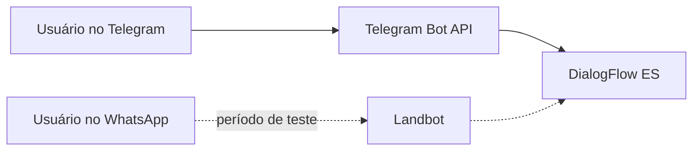

# Brotinho: Chatbot com DialogFlow, Telegram e WhatsApp

Projeto de estudo desenvolvido durante o curso "IA, Muito além do prompt" do Senac. O Brotinho é um
assistente virtual sobre plantas, criado no DialogFlow ES e integrado ao Telegram, onde
está funcional. Também foi integrado ao WhatsApp, por meio do Landbot,
durante o período de teste gratuito.

## Sobre o projeto

O Brotinho ajuda o usuário a cuidar de plantas: indica espécies de acordo com a
iluminação do ambiente, orienta sobre pragas, apresenta opções de compra e informa sobre
cursos. Ao final do atendimento, pede uma avaliação da conversa.

## Funcionalidades

- **Recomendação de plantas:** sugere espécies conforme a quantidade de luz do local
- **SOS Pragas:** orientações para identificar e tratar pragas
- **Compra de plantas:** apresenta opções disponíveis
- **Cursos:** informações sobre o curso profissional
- **Avaliação:** pergunta se o atendimento ajudou
- **Fallback:** resposta para mensagens não reconhecidas

## Integrações

| Plataforma | Status |
|---|---|
| Telegram | Ativa |
| WhatsApp (via Landbot) | Desativada: funcionou durante o período de teste gratuito |

## Arquitetura


## Tecnologias

- DialogFlow ES (intents e contextos)
- Integração nativa DialogFlow e Telegram
- Landbot (integração com o WhatsApp)

## Estrutura

```
├── agent.json      # configurações do agente
├── package.json    # versão do formato de exportação
├── intents/        # intents, frases de treino e respostas
```

## Como reproduzir

1. Compacte em um `.zip` os arquivos `agent.json`, `package.json` e a pasta `intents/`
2. Crie um agente no [DialogFlow ES](https://dialogflow.cloud.google.com/).
3. Nas configurações do agente, em **Export and Import**, use **Restore from ZIP**.
4. Crie um bot no Telegram com o **@BotFather** e copie o token gerado.
5. Em **Integrations > Telegram**, cole o token e ative a integração.

O token do bot não está incluído neste repositório, por segurança.

## Aprendizados

- Modelagem de intents e frases de treino em português
- Uso de contextos para conduzir o fluxo da conversa
- Integração de um agente conversacional com uma plataforma de mensagens
- Integração do mesmo agente em mais de um canal de mensagens (Telegram e WhatsApp)

## Créditos

Projeto desenvolvido como parte do curso "IA, muito além do prompt", do Senac.